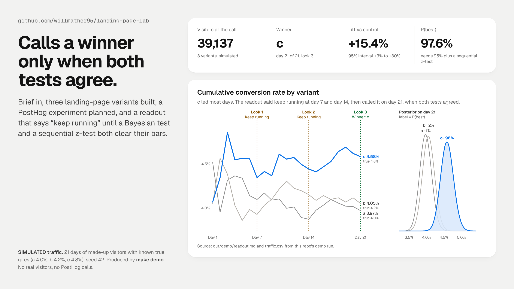
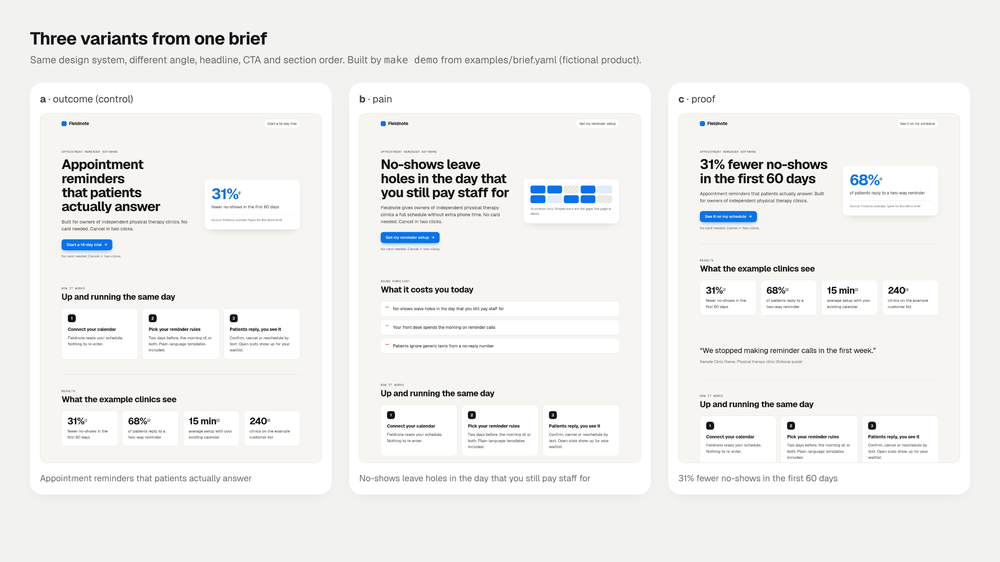
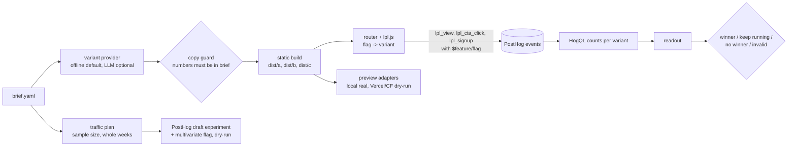

# landing-page-lab

**Brief in, landing-page test out: variants, static previews, a PostHog experiment, and a readout that calls a winner only when the stats agree.**



> **What's real and what isn't**
>
> | Part | Status |
> |---|---|
> | Variant generator (offline), copy guard, static site build, flag-routing runtime, local preview | **Real.** Runs on your machine, fully tested. |
> | Stats: Bayesian beta-binomial, group-sequential z-test, SRM check | **Real.** Checked against published boundary tables and Monte Carlo. |
> | Traffic, conversions and every number in the hero and Results | **SIMULATED.** Made-up visitors with known true rates, from `make demo` and `lpl calibrate`. |
> | Example brief ("Fieldnote") | **Fictional.** Product, quote and every proof figure are invented for the demo. |
> | PostHog experiment, flag and query calls | **Dry-run.** Real endpoint paths and payload shapes, printed, never sent. Live mode needs a sandbox project and 5 env guards. Not yet run against a live project. |
> | Vercel and Cloudflare Pages preview deploys | **Wired, not executed.** Dry-run only here. No tokens. Preview-only by construction. |
> | LLM variant provider (Anthropic Messages API shape) | **Wired, not executed.** Refuses to run without an explicit opt-in and a key. |

## Which part of the agent stack this is

I build marketing systems as four parts an agent needs: **TRUTH** (live data), **HANDS** (APIs it can act through, behind limits), a **HOME** (runs on a schedule) and **TOOLS**.

This repo is a **TOOL with guarded HANDS**. It gives an agent two calls, `create_experiment()` and `readout()`, so it can launch a landing-page test and then ask "is it done?" without being able to fool itself. The HANDS are PostHog and the preview hosts, all dry-run by default. TRUTH comes from PostHog event counts (or [marketing-warehouse](https://github.com/willmather95/marketing-warehouse)). The HOME is [channel-loop](https://github.com/willmather95/channel-loop), which calls `readout()` on the planned look days.

## Quickstart

Python 3.12+, no credentials, about a minute.

```bash
python3 -m venv .venv && .venv/bin/pip install -e ".[dev]"
.venv/bin/lpl demo --docs docs          # same as: make demo
.venv/bin/lpl preview out/demo/dist     # open http://127.0.0.1:8787/ (router) or /a/ /b/ /c/
.venv/bin/pytest -q                     # 116 tests
```

`lpl demo` prints:

```
variants:  a (outcome), b (pain), c (proof)
built:     out/demo/dist
plan:      12,494 visitors per arm detects a 20% relative lift on a 4.0% baseline with 80% power
           (alpha 0.05 split over 2 comparisons). At 2,000 visitors a day that is 19 days,
           rounded up to 3 full weeks. ...
posthog:   3 requests written to out/demo/posthog-requests.json (dry run)
readout:   Winner: c (+15.4% vs a, P(best) 97.6%)  [out/demo/readout.md]
SIMULATED traffic. No real visitors, no network calls.
```

The full readout is in [docs/sample-readout.md](docs/sample-readout.md) and the PostHog requests in [docs/sample-posthog-requests.json](docs/sample-posthog-requests.json).

Each command on its own:

```bash
lpl generate examples/brief.yaml                 # 3 variants with the angle and reason for each
lpl build examples/brief.yaml --out dist         # dist/a/, dist/b/, dist/c/, router at dist/index.html
lpl plan examples/brief.yaml                     # traffic plan + PostHog requests (dry run)
lpl deploy dist --adapter vercel --project lpl-demo     # preview deploy requests (dry run)
lpl simulate --rates a=0.04,b=0.042,c=0.048 --out t.csv
lpl readout --csv t.csv --day 14 --weights 34,33,33
lpl readout --counts a=13000/520,b=13000/680 --day 21
lpl calibrate --seeds 300                        # many-seed check, about 25 seconds
```

## The variants



Each variant tests one **angle**, a reason to care. The headline, subhead, CTA, hero proof and section order all follow from it. The design stays the same, so the test measures the message, not styling drift.

| Key | Angle | Headline (from the example brief) | Sections |
|---|---|---|---|
| a | outcome (control) | Appointment reminders that patients actually answer | how, proof, features, testimonial, faq, cta |
| b | pain | No-shows leave holes in the day that you still pay staff for | problem, how, proof, testimonial, features, faq, cta |
| c | proof | 31% fewer no-shows in the first 60 days | proof, testimonial, how, features, faq, cta |

Two more angles (steps, risk) are there for 4- and 5-arm tests. The same brief always gives the same variants, because the brief's hash seeds every choice.

**The copy guard.** Every number in generated copy must appear in the brief. "3x more bookings" fails unless the brief says 3x. It also blocks hype words, em dashes, over-long lines, unknown sections and shared headlines. It runs on the offline generator and on any LLM output.

## How it works



1. **Brief.** One YAML file with the product, audience, pains, CTAs, proof (each with a source), steps, FAQ and the experiment plan. See [examples/brief.yaml](examples/brief.yaml).
2. **Plan.** It sizes the test for the brief's baseline rate and minimum lift, splits alpha over the challenger comparisons, and rounds up to whole weeks so each look sees every weekday equally. Looks go on days 7, 14, 21 and so on.
3. **Build.** Plain HTML and one shared CSS file, no build tool. `dist/index.html` is a router that asks the PostHog flag for this visitor's variant and redirects to `/a/`, `/b/` or `/c/`. With no PostHog key it runs in **local mode**: sticky hash bucketing with the same weights, and events go to `localStorage`. `?lpl_variant=c` forces a variant for QA.
4. **Experiment.** It creates a **draft** PostHog experiment (which creates the linked flag), then pins the exact rollout on the flag. It refuses to reuse an existing flag key. Launch is a separate call, so creating never starts traffic. PostHog requires the control to be named `control`, so page `a` maps to flag value `control`.
5. **Counts.** One HogQL query returns unique exposed people and converters per variant. Flag and event names go in as query values, not pasted into SQL.
6. **Readout.** It decides with the gates below.

### The readout

A winner is called only when **all** of these pass at a **planned look**:

| Gate | Rule (defaults) |
|---|---|
| Sample ratio | Chi-square on visitors vs the flag's planned split (34/33/33, not "equal"). p < 0.001 stops the test as invalid. |
| Minimum sample | At least 1,000 visitors and 30 conversions in every arm. |
| Bayesian | Beta(1, 1) prior. The leader's probability to be best is at least 95%, and its expected loss is at most 1% of the control rate. Computed by numerical integration, so it is exact and repeatable. Monte Carlo is a cross-check in the tests. |
| Sequential z-test | The leader beats control (or control beats every challenger) with \|z\| past the Lan-DeMets O'Brien-Fleming boundary for this look. Alpha is split across comparisons (Bonferroni). Boundaries come from recursive numerical integration, not a lookup table. |

Between looks the numbers show, but no call is made. At the last look with no winner, the answer is "no winner, keep control."

**Why both tests?** The Bayesian gate answers "which one should I ship, and what do I risk?" The sequential test bounds false winners, even though an agent checks again and again. Requiring both makes the readout harder to fool than either alone.

## Results (SIMULATED)

All numbers come from running this repo. None are from real traffic.

**The demo run** (seed 42, true rates a 4.0%, b 4.2%, c 4.8%, 2,000 visitors a day): the readout said keep running on day 7 (c's P(best) 64.9%) and day 14 (81.5%), then called **c** on day 21 with P(best) 97.6%, z 2.45 against a boundary of 2.26, and a measured lift of +15.4% (95% interval +3.0% to +29.8%). The true lift was +20%.

**Calibration** ([docs/calibration.md](docs/calibration.md), `lpl calibrate --seeds 300`, 300 seeds per row):

| Scenario | Right winner | Wrong winner | No winner | SRM stop | Mean call day |
|---|---:|---:|---:|---:|---:|
| A/A/A: all 4.0% | n/a | 2.3% | 97.7% | 0.0% | |
| c is +20% (the planned effect) | 77.0% | 0.0% | 23.0% | 0.0% | 17.2 |
| demo truth: b +5%, c +20% | 67.3% | 0.0% | 32.7% | 0.0% | 17.2 |
| c is +10% (half the planned effect) | 22.0% | 0.0% | 78.0% | 0.0% | 18.7 |
| broken split 37/32/31 | 0.0% | 0.0% | 0.0% | 100.0% | |

On the same A/A/A traffic, stopping on the first day any p < 0.05 calls a false winner in **40.3%** of runs. This readout does it in **2.3%**.

What that means in plain terms:

- When nothing is different, it almost never makes up a winner.
- When the effect is as big as planned, it finds the right one about 3 times in 4. That is close to the 80% the plan targets. The Bayesian gate costs a little power, on purpose.
- In the 1,200 runs where one variant really was better, it never called a worse one.
- A broken traffic split is caught every time, before anyone reads the results.

## Python API (for agents and channel-loop)

```python
from landing_page_lab import create_experiment, readout

handle = create_experiment("examples/brief.yaml", out_dir="out/exp")   # offline + dry-run by default
handle.plan.look_days        # (7, 14, 21)
handle.weights               # (34.0, 33.0, 33.0), the flag's exact split

r = readout({"a": (13_600, 545), "b": (13_200, 530), "c": (13_200, 690)}, day=21, handle=handle)
r.status, r.winner           # (Status.WINNER, "c")
r.to_markdown(); r.to_json()
```

With a live sandbox project, swap in `PostHogClient.live()` and pull counts with `client.fetch_counts(flag_key, handle.variants, event="lpl_signup", start=..., end=...)`.

## Safety and limits

- **Offline by default.** No command makes a network call unless you opt in. The tests and demo run with no network.
- **PostHog live mode** needs `LPL_POSTHOG_LIVE=1`, an https host, a project ID, a personal API key, and `POSTHOG_SANDBOX_PROJECT_ID` equal to the project ID. Experiments are created as drafts. Existing flags are never reused.
- **Deploys are preview-only.** Vercel requests never carry `target: production`. Cloudflare refuses `main`, `master`, `production` or your named production branch. Any project in `LPL_PROTECTED_PROJECTS` is refused. Live deploys also need `LPL_DEPLOY_LIVE=1` and a token. I never point this at my own production sites.
- **The local preview** binds to 127.0.0.1 only and sends `noindex`. Built pages carry `<meta name="robots" content="noindex">`.
- **Escaping.** Every brief string is HTML-escaped. Config JSON is escaped so it cannot close its `<script>` tag (tested).
- **Known limits.** Boundaries use planned calendar fractions (days 7/14/21 of 21), not observed information. That is fine when traffic is steady. Bonferroni is conservative with many arms. The Cloudflare adapter hashes assets with SHA-256, while wrangler uses BLAKE3, so pass a BLAKE3 `asset_hash` before going live. The metric is one conversion event per person. Revenue and other continuous metrics are not built yet.

## Tests

```bash
.venv/bin/pytest -q              # 116 passed, about 13 seconds
.venv/bin/pytest -q -m "not slow"   # skips the many-seed simulation tests
```

What they cover:

- **Stats.** Chi-square and gamma against table values. O'Brien-Fleming boundaries against published Lan-DeMets values (3.71, 2.51, 1.99). Type I error held at 5% by a 40,000-run Monte Carlo. Grid P(best) and expected loss against Monte Carlo. SRM with unequal planned splits.
- **Readout.** Every gate, between-look refusal, control wins, SRM override, Bayesian veto.
- **Simulation.** Recovers the true winner across seeds, A/A false winners at or under alpha, naive peeking at 20% or more, SRM caught.
- **Copy guard.** Invented numbers, hype, em dashes, LLM output rejected.
- **Site.** Layout, manifest hashes, section order per variant, escaping, LocalPreview over HTTP.
- **Browser runtime.** `lpl.js` runs in Node: bucketing matches weights, stays sticky, maps flags to pages, routes and forces, and tags events.
- **Adapters and API.** PostHog payloads and guards, Vercel and Cloudflare request sequences and refusals, the CLI end to end.

CI runs ruff and pytest on Python 3.12 and 3.13 ([.github/workflows/ci.yml](.github/workflows/ci.yml)).

## Layout

```
src/landing_page_lab/
  brief.py            brief schema + validation
  variants/           provider interface, offline generator, LLM provider, copy guard
  site/               HTML renderer, shared CSS, build to dist/<variant>/
  posthog/            REST client (experiments, flags, HogQL counts), snippet config, lpl.js runtime
  deploy/             LocalPreview, VercelPreview, CloudflarePagesPreview
  stats/              beta-binomial, group-sequential z-test, SRM, small numeric helpers
  readout.py          the decision
  simulate.py         SIMULATED traffic with known truths
  calibrate.py        many-seed scenarios
  api.py              create_experiment(), readout()
  chart.py demo.py    hero chart and the demo pipeline
examples/brief.yaml   fictional example brief
docs/                 hero, screenshots, calibration, sample readout
```

## Related repos

- [channel-loop](https://github.com/willmather95/channel-loop): the agent loop that calls `create_experiment()` and `readout()` on a schedule.
- [marketing-warehouse](https://github.com/willmather95/marketing-warehouse): the DuckDB TRUTH layer agents read instead of live APIs.
- [conversion-tracking-agent](https://github.com/willmather95/conversion-tracking-agent): makes sure the conversion event this test counts fires exactly once.
- [world-class-charts](https://github.com/willmather95/world-class-charts): the chart rules and tokens the hero follows.
- [agent-ops-showcase](https://github.com/willmather95/agent-ops-showcase): how I run agents with a yes on every ship.

## License

MIT. See [LICENSE](LICENSE).
